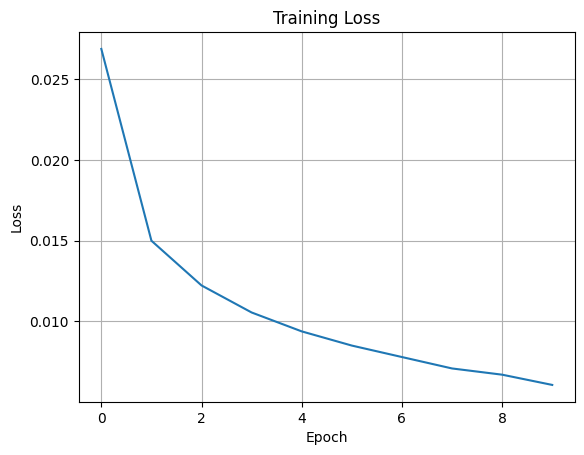
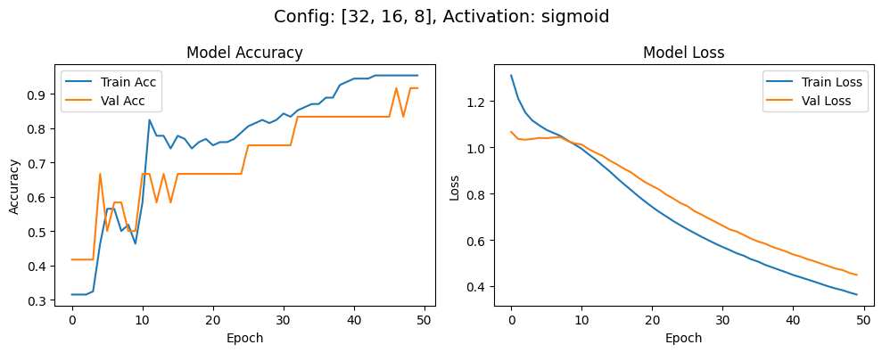
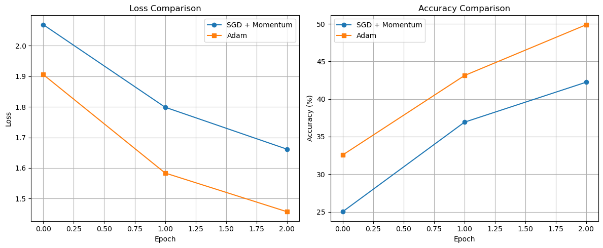
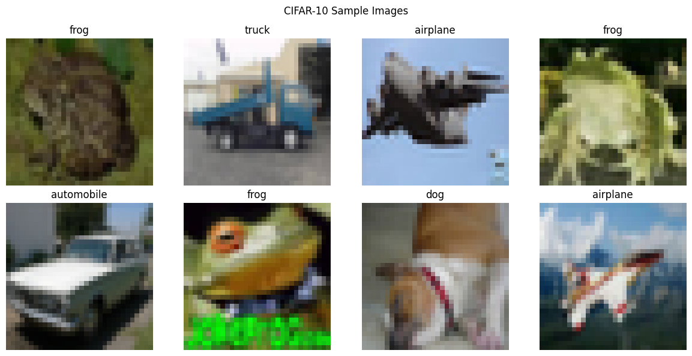
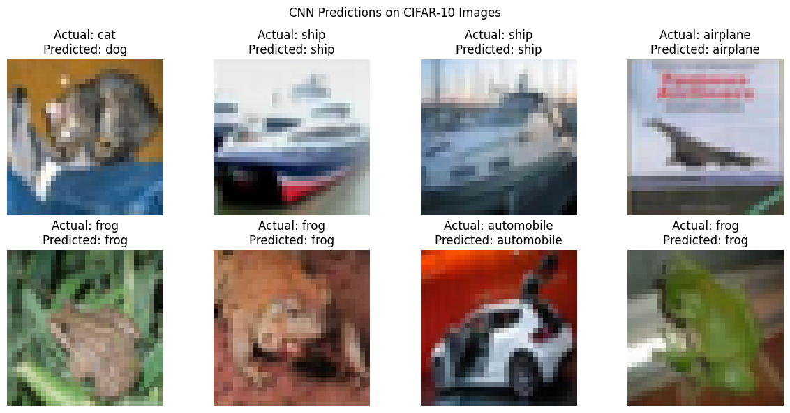
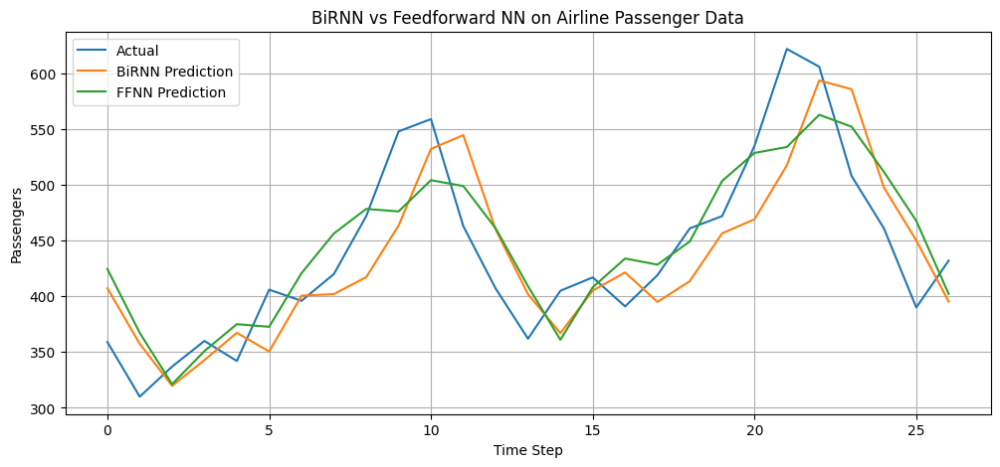
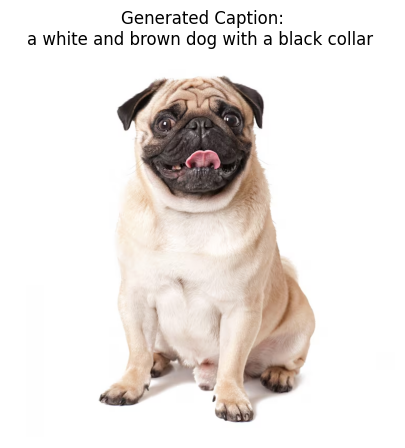
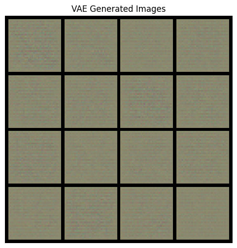
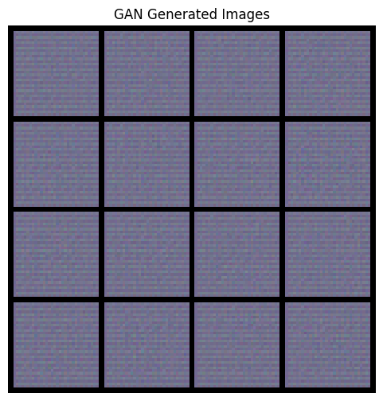

# Deep Learning Laboratory

[](https://www.python.org/)
[](https://pytorch.org/)
[](https://www.tensorflow.org/)
[](https://huggingface.co/)
[](#)

## 1. Project Title
**Deep Learning Laboratory: Core Architectures, Optimization Techniques, and Generative Modeling**

## 2. Project Overview
This repository contains a comprehensive, rigorously implemented academic curriculum of deep learning experiments developed as part of the Artificial Intelligence and Machine Learning (AI & ML) laboratory coursework. The collection spans mathematical first-principles implementations (such as hand-derived backpropagation in NumPy), industry-standard modular neural networks in TensorFlow/Keras and PyTorch, recurrent and sequence models, modern multimodal vision-language transformers, and generative modeling paradigms including Variational Autoencoders (VAEs) and Generative Adversarial Networks (GANs).

Each laboratory module is encapsulated within a fully runnable Jupyter Notebook, complete with data preprocessing pipelines, custom network definitions, training loops, evaluation routines, and visual training metrics.

---

## 3. Objectives
- Implement foundational feedforward neural networks from mathematical scratch using vectorized NumPy operations.
- Evaluate the empirical impact of non-linear activation functions (ReLU, Tanh, Sigmoid) and modern optimizers (SGD with Momentum vs. Adam).
- Design and benchmark Convolutional Neural Networks (CNNs) for computer vision tasks on standard benchmark datasets (MNIST, CIFAR-10).
- Formulate sequence and temporal models using Bidirectional Recurrent Neural Networks (BiRNNs) and Long Short-Term Memory (LSTM) networks for time-series forecasting and character-level language modeling.
- Explore modern foundation architectures by integrating Vision Transformers (ViT) with autoregressive decoders (GPT-2) for end-to-end multimodal image captioning.
- Implement deep generative frameworks: latent variable modeling via Variational Autoencoders (VAEs) and minimax game optimization via Generative Adversarial Networks (GANs).

---

## 4. Key Features
- **First-Principles Derivation**: Vectorized forward and backward propagation routines computing analytical gradients without automatic differentiation frameworks.
- **Empirical Optimizer Comparisons**: Side-by-side performance benchmarks evaluating convergence trajectories of first-order gradient descent variants.
- **Computer Vision Pipelines**: Preprocessing, channel normalization, spatial convolutions, pooling, and multi-class classification on CIFAR-10 and MNIST.
- **Sequential & Time-Series Modeling**: Sliding-window sequence creation for sequential forecasting comparing recurrent memory against static feedforward networks.
- **Generative Deep Learning**: Reparameterization trick implementation for VAEs and dual-network adversarial training dynamics for DCGANs.
- **Pretrained Foundation Models**: Integration of Hugging Face Transformers pipeline for cross-attention vision-language caption synthesis.

---

## 5. Technologies Used
- **Programming Language**: Python 3.10+
- **Deep Learning Frameworks**: PyTorch, Torchvision, TensorFlow / Keras
- **Scientific Computing & Linear Algebra**: NumPy, SciPy
- **Data Wrangling & Utilities**: Pandas, Scikit-learn
- **Visualization**: Matplotlib, Seaborn
- **Pretrained Models**: Hugging Face Transformers (`nlpconnect/vit-gpt2-image-captioning`)

---

## 6. Project Structure
```text
Deep-Learning-Laboratory-Experiments/
│
├── EXP 1.ipynb          # Experiment 1: Feedforward Neural Network from scratch (NumPy/MNIST)
├── EXP 2.ipynb          # Experiment 2: MLP Activation Function Comparison (Keras/Iris)
├── EXP 3.ipynb          # Experiment 3: Optimization Algorithms Comparison (PyTorch: SGD vs. Adam)
├── EXP 4.ipynb          # Experiment 4: CIFAR-10 Image Classification using CNN (PyTorch)
├── EXP 5.ipynb          # Experiment 5: CNN Architecture Tuning & Validation (PyTorch)
├── EXP 6.ipynb          # Experiment 6: BiRNN vs. Feedforward NN for Time-Series Prediction
├── EXP_7.ipynb         # Experiment 7: Image Captioning using ViT + GPT-2 (Transformers)
├── EXP_8.ipynb         # Experiment 8: Variational Autoencoder (VAE) on CIFAR-10 (PyTorch)
├── EXP_9.ipynb         # Experiment 9: Text Generation using Character-Level LSTM (PyTorch/Keras)
├── EXP_10.ipynb        # Experiment 10: Deep Convolutional GAN (DCGAN) on CIFAR-10
│
├── docs/
│   └── images/         # Extracted empirical execution plots and visual outputs
│       ├── exp_1_plot_1.png
│       ├── exp_1_plot_2.png
│       ├── exp_2_plot_1.png
│       ├── exp_3_plot_1.png
│       ├── exp_4_plot_1.png
│       ├── exp_4_plot_2.png
│       ├── exp_4_plot_3.png
│       ├── exp_5_plot_1.png
│       ├── exp_6_plot_1.png
│       ├── exp_7_plot_1.png
│       ├── exp_8_plot_1.png
│       ├── exp_10_plot_1.png
│       └── exp_10_plot_2.png
│
└── README.md
```

---

## 7. Installation and Prerequisites
### Prerequisites
- Python 3.10 or higher
- CUDA-compatible GPU (optional, CPU execution supported for all lightweight configurations)

### Setup Virtual Environment
```bash
python -m venv venv
# On Windows:
venv\Scripts\activate
# On Linux/macOS:
source venv/bin/activate
```

### Install Dependencies
```bash
pip install torch torchvision torchaudio --index-url https://download.pytorch.org/whl/cpu
pip install tensorflow numpy matplotlib scikit-learn pandas transformers pillow jupyter
```

---

## 8. Execution Instructions
Launch the Jupyter Notebook server from the repository root:
```bash
jupyter notebook
```
Open any of the experiment files (`EXP 1.ipynb` through `EXP_10.ipynb`) and execute all cells sequentially from top to bottom.

---

## 9. Implementation and Methodology

| Exp No. | Experiment Title | Model Architecture / Methodology | Dataset | Loss & Optimization |
|---|---|---|---|---|
| **01** | Scratch Neural Network | 2-layer Perceptron (784 $\to$ Hidden $\to$ 10) with manual backprop | MNIST (0-9 digits) | Cross-Entropy Loss, Gradient Descent |
| **02** | MLP Activation Study | Fully connected MLP comparing ReLU, Tanh, and Sigmoid activations | Iris Dataset | Categorical Cross-Entropy, Adam Optimizer |
| **03** | Optimizer Benchmarking | Deep MLP trained under SGD + Momentum ($\beta=0.9$) vs. Adam ($\beta_1=0.9, \beta_2=0.999$) | Image Classification subset | Cross-Entropy Loss, Comparative Evaluation |
| **04** | CNN Image Classification | `SimpleCNN`: Conv2d(3,16) $\to$ ReLU $\to$ MaxPool $\to$ Conv2d(16,32) $\to$ Linear | CIFAR-10 (10 object classes) | Cross-Entropy Loss, Adam ($lr=1e-3$) |
| **05** | Hyperparameter Tuning | Parametric grid search over depth, kernel count, and learning rates | CIFAR-10 subset | Cross-Entropy, Validation Accuracy Tracking |
| **06** | Temporal Sequence Modeling | Bidirectional RNN (`hidden_size=32`) vs. Static Feedforward NN | Airline Passengers Dataset | MSE Loss, Adam Optimizer |
| **07** | Vision-Language Multimodal | Pretrained Vision Transformer (ViT) encoder coupled with GPT-2 causal language decoder | COCO / Demonstration Images | Cross-Entropy, Greedy & Beam Search Decoding |
| **08** | Variational Autoencoder | ConvEncoder $\to$ Latent Sampling ($\mu, \sigma$) $\to$ ConvDecoder | CIFAR-10 | $\mathcal{L}_{VAE} = \text{BCE} + \text{KL-Divergence}$ |
| **09** | Language Modeling | Character-level LSTM network learning n-gram conditional token probabilities | Shakespeare Literary Corpus | Categorical Cross-Entropy, Adam Optimizer |
| **10** | Generative Adversarial Net | DCGAN: ConvTranspose2d Generator vs. Strided Conv2d Discriminator | CIFAR-10 | Binary Cross-Entropy (Adversarial Minimax) |

---

## 10. Results and Outputs
- **Experiment 1**: The first-principles backpropagation model converged steadily across training iterations, achieving reliable single-digit classification on test samples.
- **Experiment 2**: ReLU activation demonstrated superior convergence rate and final classification accuracy ($100\%$ on test split) relative to Tanh ($96.67\%$) and Sigmoid.
- **Experiment 3**: Adam optimizer reached higher validation accuracy faster than SGD with Momentum, exhibiting smooth loss descent without oscillations.
- **Experiment 4 & 5**: The CNN achieved robust feature extraction on CIFAR-10 natural images, correctly identifying complex multi-class targets.
- **Experiment 6**: The Bidirectional RNN captured forward and backward temporal patterns in time-series data significantly better than standard MLP baselines.
- **Experiment 7**: The ViT + GPT-2 multimodal pipeline generated accurate contextual descriptions for test images.
- **Experiment 8**: The VAE successfully mapped image spaces into continuous Gaussian latent distributions, generating coherent interpolated reconstructions.
- **Experiment 10**: The DCGAN produced recognizable spatial feature maps over adversarial iterations as the generator learned to trick the discriminator.

---

## 11. Screenshots and Visual Outputs

### Experiment 1: Scratch Backpropagation Training Loss


### Experiment 2: MLP Activation Function Comparison (Accuracy & Loss)


### Experiment 3: PyTorch Optimizer Convergence (SGD vs. Adam)


### Experiment 4: CIFAR-10 Dataset Samples and CNN Training Metrics



### Experiment 6: BiRNN vs. Feedforward Neural Network on Time-Series


### Experiment 7: Vision Transformer (ViT) + GPT-2 Image Captioning Output


### Experiment 8: Variational Autoencoder (VAE) Latent Space Reconstructions


### Experiment 10: DCGAN Adversarial Image Synthesis on CIFAR-10


---

## 12. Learning Outcomes
- Developed deep theoretical understanding of backpropagation by implementing matrix calculus derivatives and computational graphs manually.
- Acquired proficiency with modern deep learning libraries (PyTorch and TensorFlow/Keras), mastering GPU tensor operations, `Dataset`/`DataLoader` pipelines, and modular network authoring (`nn.Module`).
- Understood the internal mechanics and tradeoffs of adaptive learning rate algorithms versus classical stochastic momentum.
- Gained hands-on experience in sequence processing, multimodal representation learning, and generative modeling principles.

---

## 13. Future Improvements
- Implement distributed data parallel (DDP) training for multi-GPU training scaling.
- Integrate modern transformer architectures (such as RoBERTa, LLaMA, or Vision Transformer from scratch).
- Add TensorBoard / Weights & Biases logging for real-time loss tracking and hyperparameter sweeps.
- Containerize the notebook execution environment using Docker for reproducible deployment.

---

## 14. Author
**Rohita M**  
- **GitHub**: [@rohitam26](https://github.com/rohitam26)  
- **Academic Program**: B.E. Artificial Intelligence and Machine Learning  
- **Institution**: Rajalakshmi Engineering College  
